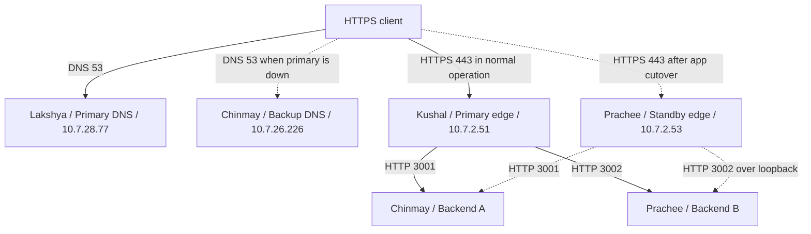

# NAN Phase 2 topology

All devices used the same LAN on 23 November 2026. The subnet was `10.7.0.0/19`, the gateway was `10.7.0.1`, and each Mac used `en0`.

Both resolvers normally answer with the primary edge IP. The test moved only `app.NAN.test` to standby and kept `api.NAN.test` on the primary. During the isolation test, PF allowed direct access to the backend ports from Kushal’s edge. The team restored direct access before testing the standby edge.

[Deployment inventory and demonstration](../docs/phase2-runbook.md) · [Packet and terminal evidence](../evidence/phase2/README.md)
